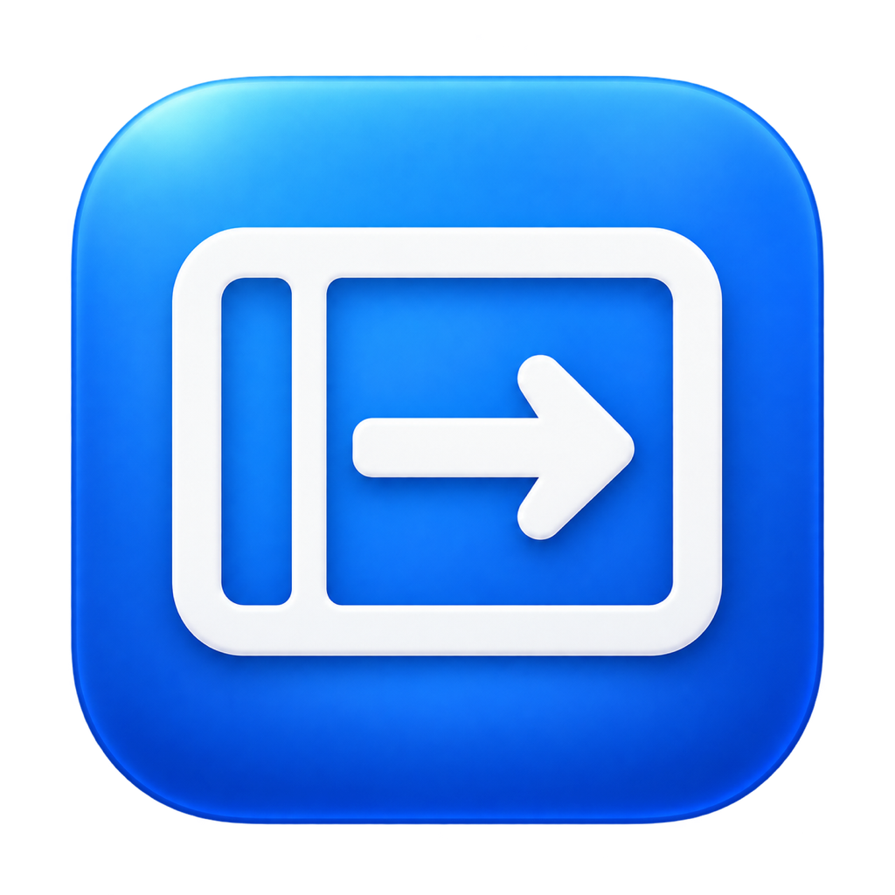
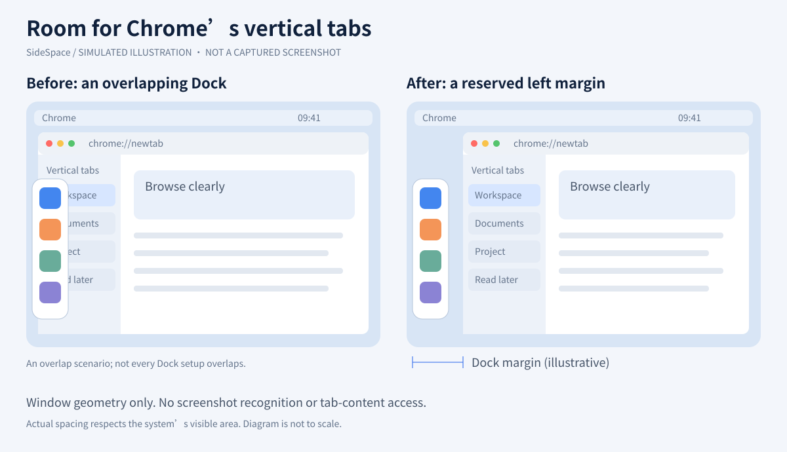
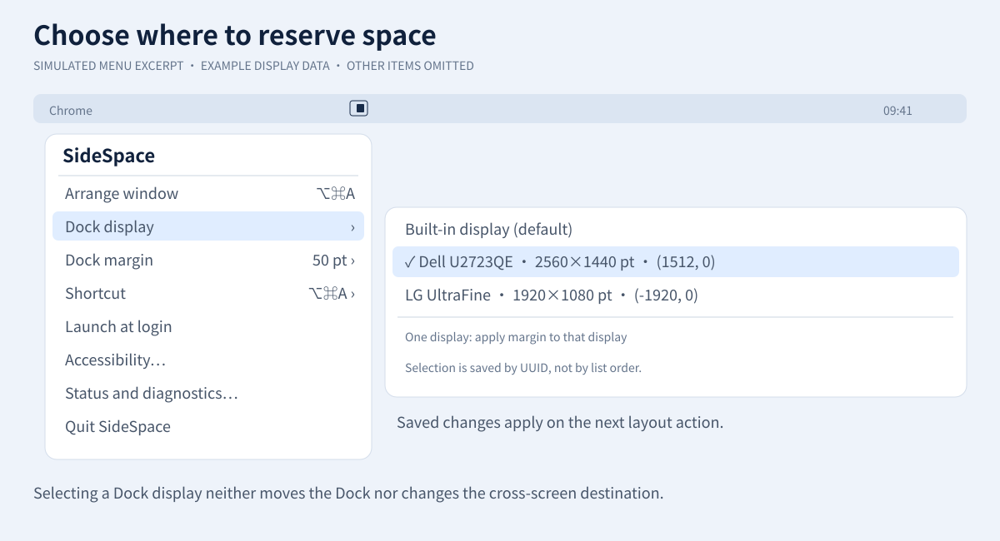
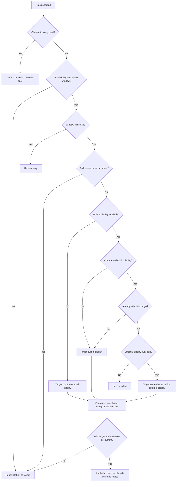

<div align="center">
  
  <h1>SideSpace · 有间</h1>
  <p><strong>Give Chrome’s vertical tabs room beside the Dock.</strong></p>
  <p>English · <a href="README_zh.md">简体中文</a></p>
</div>

SideSpace is a small native macOS menu-bar utility that positions the Google Chrome window with a configurable left margin. Choose the display where you want to reserve space for the Dock, then use one keyboard shortcut to bring Chrome forward, arrange it, or move it between the built-in and an external display.

It is designed for a **left-side Dock and Chrome vertical tabs**. It arranges the browser window; it does not enable vertical tabs, manage tabs, move the Dock, or inspect web content. The margin is always on the **left**, not automatically rotated to match the Dock’s orientation.

**Defaults:** `⌥⌘A` · 50 pt Dock margin · built-in display · Apple Silicon · macOS 26.0 deployment target.

> **Project status — September 28, 2026:** Native arm64 builds, local ad-hoc signature verification, C core tests and ASan/UBSan tests have passed. Full macOS 26/27 hardware acceptance, real multi-display behavior for the new display selector, and memory measurements remain incomplete. See the [validation report](docs/VALIDATION_REPORT.md). Building with SDK 27 does not prove runtime compatibility with macOS 27.

## Contents

- [What it does](#what-it-does)
- [Build and install](#build-and-install)
- [First launch](#first-launch)
- [Choose a Dock display and margin](#choose-a-dock-display-and-margin)
- [Exactly what the shortcut does](#exactly-what-the-shortcut-does)
- [Other settings](#other-settings)
- [Troubleshooting](#troubleshooting)
- [Privacy and implementation](#privacy-and-implementation)
- [Development and validation](#development-and-validation)
- [Scope and contributing](#scope-and-contributing)
- [Visual guide: mockups and flow](#visual-guide-mockups-and-flow)

## What it does

- Reserve a configurable strip along the left edge of a selected display.
- Choose the built-in display or a specific external display, including when multiple monitors are connected.
- Save external-display identity by UUID; keep the selection when that display is disconnected.
- Always apply the margin when only one display is connected, including closed-lid use with one external monitor.
- Respect macOS’s usable screen area, menu bar and Dock reservations.
- Use a keyboard shortcut or **Arrange window** in the menu. No browser extension or third-party runtime is required.

Example: select your external monitor as **Dock display**, set **Dock margin** to 60 pt, and move Chrome there using the shortcut. SideSpace leaves at least 60 logical points from that monitor’s left edge. The built-in screen uses its normal usable area. If the system already reserves more than 60 pt, that larger reservation wins.

The app lives in the menu bar. It has no permanent main window or Dock icon; its app icon is visible in Finder and relevant dialogs.

## Build and install

### Requirements

- An Apple Silicon Mac. The default build produces an `arm64` application.
- macOS 26.0 or later is the deployment target; macOS 26 and 27 are the intended runtime targets, with hardware validation still pending.
- A version of Xcode that runs on your Mac and provides **macOS SDK 26 or newer**. Open Xcode once, accept its license and complete component installation.
- Google Chrome stable (`com.google.Chrome`) for window control.

Check the selected toolchain:

```bash
xcode-select -p
xcrun --sdk macosx --show-sdk-version
```

If necessary, choose the correct **Command Line Tools** entry in Xcode → Settings → Locations. See Apple’s [Xcode requirements](https://developer.apple.com/xcode/system-requirements) for host/SDK compatibility. Do not raise the deployment target to 27 just because you build with SDK 27.

### Recommended: local build script

Download or clone this repository, open a terminal in its root directory, and run:

```bash
bash scripts/build.sh
```

Or double-click `Build.command` in Finder. The script uses Apple Clang and system frameworks, builds Release, and applies a local ad-hoc signature. No Homebrew, package manager, Swift packages or paid developer account is required for this local build.

Output:

```text
build/SideSpace.app
build/SideSpace.app.dSYM
```

The `.dSYM` is a separate debugging-symbol bundle; it is not required to run the app.

### Install the app

Quit any running SideSpace instance, then double-click `Install.command`, or run:

```bash
bash scripts/install.sh
```

The installer asks before replacing an existing copy and installs to:

```text
~/Applications/SideSpace.app
```

It verifies the signature and opens the installed app. Alternatively, copy the built `.app` to `/Applications` yourself. Use one fixed installation location, particularly before granting Accessibility access or enabling launch at login.

**Build output is not automatically an installed update.** After rebuilding, replace your installed copy and reopen it. Avoid running copies from multiple locations.

### Build with Xcode

Open `SideSpace.xcodeproj`, select the **SideSpace** scheme and **My Mac**, then press `⌘B` to build or `⌘R` to debug. The Run action uses Debug. In Xcode, find that product under **Products → SideSpace.app → Show in Finder**.

For a Release build with a predictable output directory:

```bash
env -u CC -u CXX bash scripts/build-xcode.sh
```

Output: `build/DerivedData/Build/Products/Release/SideSpace.app`.

The installer prefers `build/SideSpace.app` if it exists, otherwise the Xcode Release product. If you use both build methods, explicitly install the output you just built to avoid installing an older copy.

### Signing and distribution

These build paths use **ad-hoc signing**, not Developer ID signing or Apple notarization. This README documents building from source; it does not imply that a notarized download or GitHub Release exists. Local compilation does not require a paid developer account. A polished public binary release needs a separate distribution/signing workflow and completed hardware acceptance. Do not disable macOS security protections to run the app.

## First launch

1. Open SideSpace from its fixed installation location.
2. Grant the **installed SideSpace app** access in **System Settings → Privacy & Security → Accessibility**. The initial setup dialog can guide you there. Add the `.app` manually if it is not listed.
3. Use **Recheck permission and shortcut** in the menu after granting access or resolving a shortcut conflict.
4. In the menu, choose **Dock display** and **Dock margin**. Bring Chrome forward and press `⌥⌘A` to try the layout.

The permission belongs to SideSpace, not Terminal, Raycast or Chrome. Accessibility is a broad system permission; the program’s limited behavior is not an OS-enforced “Chrome only” permission boundary.

If the icon is missing while the app is running, check **System Settings → Menu Bar → Allow in the Menu Bar → SideSpace**. The system can hide the icon independently of the app’s own visibility request. This is separate from Accessibility access.

## Choose a Dock display and margin

| Setting | Behavior |
|---|---|
| **Dock display: Built-in display (default)** | Reserve the margin on the built-in display when multiple displays are connected. |
| **Dock display: a named external display** | Reserve the margin on that specific monitor. Entries include its name, logical size and global coordinates to distinguish similar displays. |
| **Selected display disconnected** | Keep the saved UUID and show a disconnected entry. With multiple screens, do not transfer the margin to another screen. Reconnecting with the same UUID restores matching. |
| **Only one connected display** | Apply the margin there, regardless of the saved selection. The saved selection itself is retained. |
| **Dock margin** | Default 50 pt. Presets: 0, 30, 40, 50, 60, 80, 100, 120 pt. Custom integer: 0–500. |

The setting is a **manual layout preference**, not a Dock detector. SideSpace neither moves the Dock nor reads its position or auto-hide setting. A reserved margin remains part of the target layout even when the Dock is hidden. If you move the Dock to another monitor, update the selection yourself.

Changing the display or margin saves the preference; it does **not** move Chrome immediately. It takes effect on the next layout action.

### How the margin is calculated

For the selected display—or the sole connected display:

```text
left   = max(screen.left + configuredMargin, visibleFrame.left)
right  = visibleFrame.right
top    = visibleFrame.top
bottom = visibleFrame.bottom
```

Other displays use `visibleFrame`. Units are macOS logical points, not physical Retina pixels. The margin is measured from the screen edge, **not added to the Dock width**. For a 50 pt setting and a system-reserved 70 pt strip, the resulting left inset is 70 pt, not 120 pt. A value of 0 still respects system reservations. Layouts leaving less than 100 pt of target width are rejected.

**Dock display and cross-screen destination are independent.** Selecting monitor B for the Dock does not force every cross-screen move to B. Cross-screen moves use the most recently used external display if still connected, otherwise the first external display in the system’s enumeration.

## Exactly what the shortcut does

One key press performs one step. It does not activate Chrome and rearrange it in the same invocation.

| Chrome state at the time of the press | Result |
|---|---|
| Not running | Request launch; no layout. |
| In the background or hidden | Bring it forward; it may restore a minimized window, but does not change its position or size. |
| Foreground, selected window minimized | Restore the window only. |
| Foreground on built-in display, not at its target frame | Arrange on the built-in display. Apply the margin only if that display is selected, or it is the sole display. |
| Foreground on built-in display, already at target, external available | Move to an external display and apply that display’s target frame. |
| Foreground on external display, built-in available | Return to the built-in display and apply its target frame. **There is no extra external “normalize first” step.** |
| Only built-in display, already at target | Keep the window as it is. |
| No built-in display available | Arrange on the current external display; keep it if already arranged. No cycling among external displays. |
| Full-screen window, modal sheet, missing usable window or permission failure | Report the condition rather than forcing a layout. |

The target frame compares **X, Y, width and height**, with a 3 pt tolerance. With several external-only screens, only the selected screen gets the configured margin; the single-screen override applies only when exactly one display is available.

## Other settings

- **Shortcut:** `⌥⌘A` (default), `⌥A`, `⌃⌥⌘→`, or a custom shortcut. A custom shortcut needs Control, Option or Command; Shift can be added. Recording is local to the settings control and pauses the previous binding. Existing saved shortcuts are preserved.
- **Launch at login:** opt-in, using `SMAppService`. Install to a fixed path first. If macOS requires approval, the menu reports it.
- **Language:** follow the system or choose English, Simplified/Traditional Chinese, Japanese, Korean, German, French, Spanish, Portuguese, Italian or Russian.
- **Status and diagnostics:** reports permissions, shortcut registration, margin and the most recent operation. Memory entries show local measurements when available; they are not performance guarantees.

## Troubleshooting

| Symptom | What to check |
|---|---|
| First press only shows Chrome | Intended: press again once Chrome is in front to perform a layout. |
| Shortcut does nothing or registration fails | Check the diagnostic status, free the binding in Raycast or another app, or choose another shortcut; recheck afterward. Successful registration does not prove every third-party conflict is absent. |
| App is running but the icon is missing | Check the system’s **Allow in the Menu Bar** switch for SideSpace and available menu-bar space. |
| No movement after granting access | Confirm access is granted to the copy actually running. After rebuilding with ad-hoc signing, remove an obsolete Accessibility entry and add the new installed copy if needed. |
| Wrong display gets the margin | Check **Dock display**. It is manual, separate from the remembered external destination. With one screen, the margin intentionally applies there. |
| External monitor appears disconnected after reconnecting | Some adapters, docks or virtual displays can change display identity. Select the monitor again. |
| Changes do not appear | Quit the old app, rebuild, replace the installed copy, and reopen it. Check which of the two build outputs was installed. |
| SDK module errors or sanitizer startup problems | Avoid an inherited Homebrew `CC`/`CXX` override. Use the Apple toolchain commands below. |

## Privacy and implementation

The app reads application/window state and geometry through Accessibility and uses that to arrange Chrome. It does not read page text, tab contents or URLs, capture screenshots, track usage, upload telemetry or use a network client. Screen Recording, Input Monitoring and Full Disk Access are not required.

- C: geometry/state machine, Accessibility adapter, hotkeys and preferences.
- Objective-C with ARC: AppKit menus/dialogs, display bridging and orchestration.
- Main thread: AppKit and screen snapshots. Serial queue: bounded AX IPC and retries, with autorelease pools.
- Display/sleep changes cancel stale work. There is no continuous Dock scanning or background window polling.
- Timers are scoped to visible UI: memory sampling while the menu is open and permission checks while the onboarding panel is open. Layout operations use bounded delayed retries.
- No Swift, Electron, WebView, Rust, third-party packages, subprocesses or script runtime in the shipped app. Repository shell scripts are build/test tools, not app runtime components.

The bundle identifier and preferences domain are `com.jimmyliang.SideSpace`. `dockDisplayUUID` is separate from `lastExternalUUID`; the existing `leftMargin` setting is retained. No private CGS APIs are used to bypass activation or permission policy.

## Development and validation

```text
SideSpace.xcodeproj/          Xcode project and shared scheme
Config/                      Build configuration and Info.plist
Sources/Core/                C layout, AX, hotkey and preference code
Sources/App/                 Objective-C UI, localization and orchestration
Resources/                   Icons and 11 localization tables
Tests/layout_tests.c         Portable geometry/state-machine tests
scripts/                     Build, install, test and measurement tools
docs/                        Validation records, native checklist and illustrations
```

Run the portable core tests:

```bash
bash scripts/test-core.sh
SANITIZE=1 bash scripts/test-core.sh
```

For a Mac with a conflicting compiler environment, explicitly select Apple Clang and the SDK:

```bash
CC="$(xcrun --find clang)" \
SDKROOT="$(xcrun --sdk macosx --show-sdk-path)" \
SANITIZE=1 bash scripts/test-core.sh
```

Latest recorded result:

```text
PASS: 160057 checks (deterministic + 20,000 randomized layout cases)
```

These tests do not exercise AppKit, TCC, hotkey interaction or real Chrome/display movement. They are not an XCTest target; `⌘U` is not a substitute. Follow the [native checklist](docs/MAC_TEST_CHECKLIST.md) separately on macOS 26 and 27. The [validation report](docs/VALIDATION_REPORT.md) distinguishes completed checks from outstanding work and preserves earlier failures.

To measure an installed Release build, quit the debugger and sanitizer runs, then run `bash scripts/measure-memory.sh`. Compare physical footprint and private dirty memory across cold start and repeated use; do not treat virtual address space as resident memory. There is no verified “only a few MB” claim.

## Scope and contributing

SideSpace currently targets Google Chrome stable, one selected ordinary window at a time. It is not a general window manager, tab manager, Chrome extension, full-screen controller or drag-to-snap utility. It does not automatically track Dock movement. Intel builds, mirrored displays, Sidecar and virtual-display arrangements are not accepted hardware configurations yet. There is no automatic updater or App Store publishing pipeline.

For an issue, include macOS version, build method, app version, display arrangement/scaling, selected Dock display, margin, shortcut and reproduction steps. Redact private paths and any unrelated window content. For code changes, follow [AGENTS.md](AGENTS.md), run the relevant tests, and report only validation actually performed. Keep the first-press activation rule and user-controlled settings intact.

Licensed under [MIT](LICENSE). SideSpace is an independent project and is not affiliated with Google or Apple.

## Visual guide: mockups and flow

### 1. The space you are reserving



**Simulated illustration, not a captured screenshot or a scale measurement.** It illustrates an overlapping Dock scenario and the intended reserved strip. Actual geometry depends on `visibleFrame`, your margin and display settings; SideSpace does not measure individual Dock icons.

### 2. Selecting the screen



**Simulated menu excerpt.** Monitor names, dimensions and coordinates are examples. Unrelated menu entries are omitted for clarity. The chosen Dock display controls where space is reserved; it does not set the next cross-screen destination.

### 3. One shortcut press



Target-frame rule: **one display → reserve margin there; multiple displays → reserve margin only on the selected display; all other targets → system visible area.** Every branch ends after this invocation; activating Chrome does not loop back into layout.
