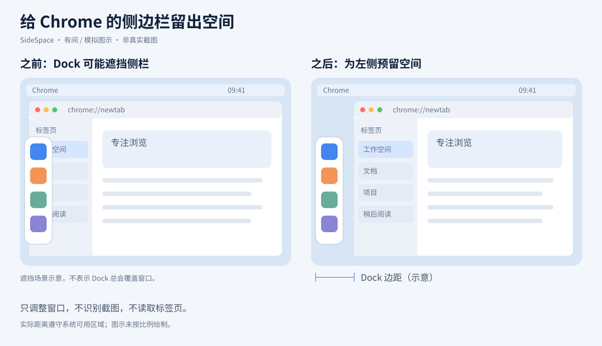
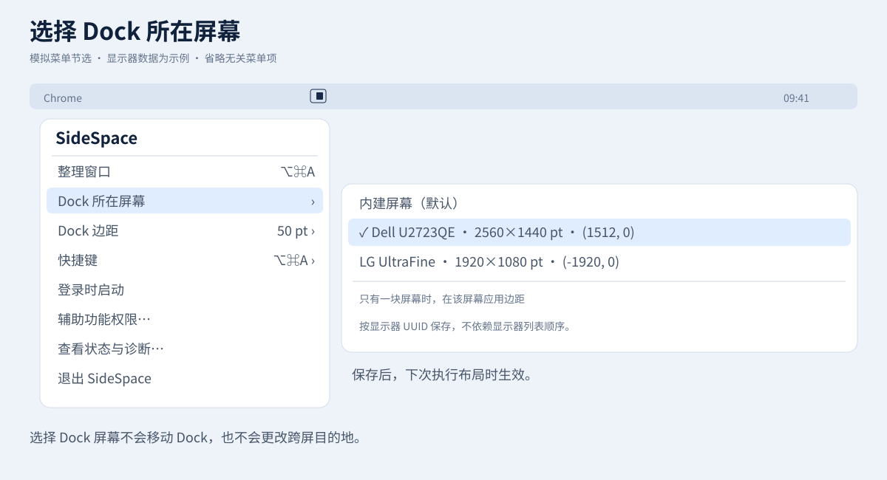
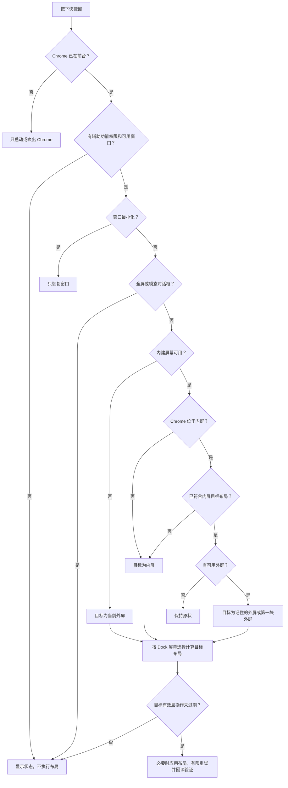

<div align="center">
  
  <h1>SideSpace · 有间</h1>
  <p><strong>给 Chrome 垂直标签页，留一点 Dock 旁的空间。</strong></p>
  <p><a href="README.md">English</a> · 简体中文</p>
</div>

SideSpace 是一款原生 macOS 菜单栏小工具，为 Google Chrome 窗口预留可调节的左边距。选择需要避让 Dock 的显示器，再用一个快捷键唤出 Chrome、整理窗口，或在内建屏幕和外接屏幕之间切换。

它面向 **左侧 Dock 搭配 Chrome 垂直标签页**的使用场景。它调整的是浏览器窗口，不负责开启垂直标签页、管理标签页、移动 Dock 或读取网页。边距始终留在**左侧**，不会根据 Dock 朝向自动改为右侧或底部。

**默认：`⌥⌘A` · Dock 边距 50 pt · Dock 所在屏幕为内建屏幕 · Apple Silicon · 最低部署版本 macOS 26.0。**

> **项目状态 — 2026 年 9 月 28 日：** 已通过原生 arm64 构建、本地 ad-hoc 签名校验、C 核心测试和 ASan/UBSan 测试。macOS 26/27 完整真机验收、新屏幕选择功能的真实多屏操作以及内存测量仍未完成。详见[验证报告](docs/VALIDATION_REPORT.md)。使用 SDK 27 编译成功，不代表已经验证 macOS 27 运行兼容性。

## 目录

- [它能做什么](#它能做什么)
- [构建与安装](#构建与安装)
- [首次使用](#首次使用)
- [设置 Dock 屏幕与边距](#设置-dock-屏幕与边距)
- [快捷键究竟做什么](#快捷键究竟做什么)
- [其他设置](#其他设置)
- [常见问题](#常见问题)
- [隐私与技术实现](#隐私与技术实现)
- [开发与验证](#开发与验证)
- [功能范围与参与贡献](#功能范围与参与贡献)
- [图解：模拟界面与逻辑流程](#图解模拟界面与逻辑流程)

## 它能做什么

- 在指定屏幕左侧为 Chrome 预留一段空间。
- 选择内建屏幕或某一块外接屏幕，支持连接多块外屏时分别识别。
- 用显示器 UUID 保存外屏选择，断开后仍保留设置。
- 只有一块屏幕时，自动在当前屏幕应用边距，包括合盖后仅使用一块外屏。
- 尊重 macOS 系统可用区域，不覆盖系统为菜单栏和 Dock 预留的空间。
- 通过快捷键或菜单中的窗口整理入口触发，不需要浏览器扩展或第三方运行环境。

例如：将 **Dock 所在屏幕**设为外接显示器，**Dock 边距**设为 60 pt，再用快捷键把 Chrome 移到该显示器。窗口会距离该屏幕左边缘至少 60 个逻辑点；内屏则使用正常的系统可用区域。如果系统已经预留超过 60 pt，就使用更大的系统预留值。

SideSpace 常驻菜单栏，没有永久主窗口或 Dock 图标；应用图标会显示在 Finder 和相关弹窗中。

## 构建与安装

### 环境要求

- Apple Silicon Mac，默认构建生成 `arm64` 程序。
- 最低部署版本为 macOS 26.0；目标运行系统为 macOS 26 和 27，完整真机验收待完成。
- 能在当前 Mac 上运行、且提供 **macOS SDK 26 或更新版本**的 Xcode。首次打开 Xcode 时接受许可并完成组件安装。
- Google Chrome 正式版（`com.google.Chrome`），用于窗口控制。

检查工具链：

```bash
xcode-select -p
xcrun --sdk macosx --show-sdk-version
```

如有需要，在 Xcode → Settings → Locations 中选择正确的 **Command Line Tools**。宿主系统与 SDK 的对应要求请查阅 [Apple Xcode 支持矩阵](https://developer.apple.com/xcode/system-requirements)。不要因为使用 SDK 27，就把最低部署版本提高到 27。

### 推荐：使用本地构建脚本

下载或克隆本仓库，在项目根目录打开终端，运行：

```bash
bash scripts/build.sh
```

也可在 Finder 双击 `Build.command`。脚本使用 Apple Clang 和系统 Framework，构建 Release 并进行本地 ad-hoc 签名。这个本地构建流程不需要 Homebrew、包管理器、Swift Package，也不需要付费开发者账号。

产物：

```text
build/SideSpace.app
build/SideSpace.app.dSYM
```

`.dSYM` 是独立调试符号，运行应用不需要安装它。

### 安装应用

退出正在运行的 SideSpace，然后双击 `Install.command`，或运行：

```bash
bash scripts/install.sh
```

安装脚本会在覆盖旧版前询问，并安装到：

```text
~/Applications/SideSpace.app
```

完成后校验签名并打开应用。也可以自行把生成的 `.app` 复制到 `/Applications`。选择一个固定安装位置，尤其是在授予辅助功能权限、开启登录启动之前。

**重新构建不会自动更新已安装的应用。** 构建完成后，需要替换安装副本并重新打开。避免同时运行不同目录中的多个副本。

### 使用 Xcode

打开 `SideSpace.xcodeproj`，选择 **SideSpace** Scheme 和 **My Mac**，按 `⌘B` 构建或 `⌘R` 调试。Run 使用 Debug 配置，可在 **Products → SideSpace.app → Show in Finder** 找到对应产物。

如需生成路径固定的 Release 版本：

```bash
env -u CC -u CXX bash scripts/build-xcode.sh
```

产物：`build/DerivedData/Build/Products/Release/SideSpace.app`。

安装脚本优先使用 `build/SideSpace.app`，不存在时才使用 Xcode Release 产物。若两种构建方式都用过，请明确安装刚生成的那一份，避免安装旧产物。

### 签名与对外分发

上述构建使用 **ad-hoc 本地签名**，不是 Developer ID 签名或 Apple 公证。本说明介绍从源码构建，不意味着仓库已经提供公证下载或 GitHub Release。本机编译不需要付费开发者账号；正式面向普通用户分发二进制，还需要单独安排签名、公证流程和完整真机验收。不要通过关闭系统安全机制来运行程序。

## 首次使用

1. 从固定安装目录打开 SideSpace。
2. 在 **系统设置 → 隐私与安全性 → 辅助功能**中允许实际安装的 SideSpace。首次弹窗会引导授权；列表中没有应用时可手动添加 `.app`。
3. 授权或解决快捷键冲突后，使用菜单中的**重新检查权限与快捷键**。
4. 设置 **Dock 所在屏幕**和 **Dock 边距**，让 Chrome 位于前台，再按 `⌥⌘A` 尝试布局。

需要授权的是 SideSpace，而不是 Terminal、Raycast 或 Chrome。辅助功能是系统级的强权限；程序只操作 Chrome 是实现上的范围限制，不代表 macOS 为它提供了“仅限 Chrome”的权限边界。

如果程序在运行却没有菜单栏图标，请检查 **系统设置 → 菜单栏 → 允许在菜单栏显示 → SideSpace**。系统可以独立于应用的显示请求隐藏图标；这个开关与辅助功能权限无关。

## 设置 Dock 屏幕与边距

| 设置 | 行为 |
|---|---|
| **Dock 所在屏幕：内建屏幕（默认）** | 多屏时，只在内屏额外预留边距。 |
| **Dock 所在屏幕：指定外接显示器** | 只在该显示器额外预留边距。菜单列出名称、逻辑尺寸和全局坐标，方便区分同型号显示器。 |
| **选中的外接屏幕未连接** | 保留 UUID 并显示未连接项；多屏时不把边距转移到其他屏幕。重新接入且 UUID 相同时恢复匹配。 |
| **当前只有一块屏幕** | 无论保存的选择是什么，都在当前屏幕应用边距，但不会改掉已保存的选择。 |
| **Dock 边距** | 默认 50 pt；预设 0、30、40、50、60、80、100、120 pt；自定义支持 0–500 的整数。 |

这是**手动指定的布局规则**，不是 Dock 位置检测。SideSpace 不移动 Dock，不读取它的位置或自动隐藏设置；Dock 隐藏时，边距仍属于窗口目标布局。把 Dock 移到其他显示器后，请相应调整这个选项。

改变屏幕或边距设置只保存偏好，**不会立即移动 Chrome**，下次执行布局时才生效。

### 边距怎么算

对于选中的屏幕，或当前唯一屏幕：

```text
窗口左边缘 = max(屏幕左边缘 + 配置边距, 系统可用区域左边缘)
窗口右边缘 = 系统可用区域右边缘
窗口上边缘 = 系统可用区域上边缘
窗口下边缘 = 系统可用区域下边缘
```

其他屏幕使用系统 `visibleFrame`。单位是 macOS 逻辑点，不是 Retina 物理像素。边距从屏幕边缘计算，**不是在 Dock 宽度之上再加一段距离**。例如设置 50 pt，系统已经留出 70 pt，则实际左侧距离为 70 pt，而不是 120 pt。设置为 0 仍会尊重系统预留空间。目标窗口宽度不足 100 pt 的布局会被拒绝。

**Dock 屏幕选择与跨屏目标是独立设置。** 选择外屏 B 作为 Dock 屏幕，不代表每次跨屏都会前往 B。跨屏仍优先使用最近一次使用且仍连接的外屏，没有可用历史时使用系统枚举的第一块外屏。

## 快捷键究竟做什么

一次按键只执行一步，不会在唤出 Chrome 的同一次操作中继续调整布局。

| 触发时 Chrome 的状态 | 本次动作 |
|---|---|
| 未运行 | 请求启动，不执行布局。 |
| 在后台或被隐藏 | 只唤出；可能恢复最小化窗口，但不修改位置和尺寸。 |
| 在前台，选中的窗口最小化 | 只恢复窗口。 |
| 在前台、位于内屏，但不符合目标布局 | 在内屏归位；仅当内屏被选中或只有一块屏幕时应用 Dock 边距。 |
| 在前台、内屏布局已符合目标，且有外屏 | 移到外屏，并使用该外屏对应的目标布局。 |
| 在前台、位于外屏，且内屏可用 | 返回内屏并应用内屏目标布局。**没有新增“先在外屏归位，再次按键回内屏”的步骤。** |
| 只有内屏，已符合目标布局 | 保持原状。 |
| 没有内屏可用 | 在当前外屏应用布局；已符合则保持原状。不在多个外屏间轮换。 |
| 全屏窗口、模态对话框、没有可操作窗口或权限错误 | 显示状态说明，不强制布局。 |

判断目标布局时，比较完整的 **X、Y、宽度和高度**，容差为 3 pt。合盖后仍有多块外屏时，只给选中的外屏预留配置边距；“单屏自动留边距”仅在恰好只有一块屏幕时生效。

## 其他设置

- **快捷键**：默认 `⌥⌘A`，第二候选 `⌥A`，第三候选 `⌃⌥⌘→`，也可自定义。自定义组合至少包含 Control、Option 或 Command，可附加 Shift。录制只在设置控件中进行，期间暂停旧绑定；已有保存的快捷键会保留。
- **登录时启动**：用户主动开启，通过 `SMAppService` 注册。请先安装到固定目录；若 macOS 要求批准，菜单会提示。
- **语言**：跟随系统，或选择英语、简体中文、繁体中文、日语、韩语、德语、法语、西班牙语、葡萄牙语、意大利语、俄语。
- **状态与诊断**：显示权限、快捷键注册、边距和最近操作结果。内存菜单项在可用时展示本地测量值，不构成性能承诺。

## 常见问题

| 现象 | 排查方法 |
|---|---|
| 按第一次只显示 Chrome | 正常行为；Chrome 已在前台后，再按一次才会执行布局。 |
| 快捷键没反应或注册失败 | 检查诊断，解除 Raycast 等应用的同组合绑定，或选其他快捷键，再重新检查。注册成功也不保证没有第三方冲突。 |
| 程序运行着，但没有菜单栏图标 | 检查系统的“允许在菜单栏显示”开关和菜单栏可用空间。 |
| 授权后仍无法移动窗口 | 确认授权对象就是当前运行副本。ad-hoc 重新签名后，必要时删除失效的辅助功能条目并添加新安装副本。 |
| 边距出现在错误屏幕 | 检查“Dock 所在屏幕”；它与记住的跨屏目标独立。只有一块屏幕时，会特意在该屏幕应用边距。 |
| 外屏重连后仍显示未连接 | 部分转接器、扩展坞或虚拟显示器可能改变身份，请重新选择该显示器。 |
| 修改或新图标没有出现 | 退出旧程序，重新构建、替换安装并打开；注意安装的是哪一种构建产物。 |
| SDK 模块编译失败或 Sanitizer 启动异常 | 检查是否继承了 Homebrew 的 `CC`/`CXX` 覆盖，使用下方 Apple 工具链命令。 |

## 隐私与技术实现

应用通过辅助功能接口读取应用/窗口状态和几何信息，用于整理 Chrome。它不读取网页文本、标签页内容或 URL，不截图、不追踪、不上传遥测，也没有网络客户端。不需要屏幕录制、输入监控或磁盘完全访问权限。

- **C**：布局状态机、辅助功能适配、快捷键和偏好存储。
- **Objective-C / ARC**：AppKit 菜单和弹窗、显示器桥接与操作编排。
- 主线程负责 AppKit 和屏幕快照；串行队列负责有次数上限的 AX IPC 与重试，任务有独立 autorelease pool。
- 屏幕变化、睡眠时取消过期操作；没有持续 Dock 扫描或后台窗口轮询。
- 定时器限定在界面使用期间：菜单打开时采样内存，授权引导弹窗打开时检查权限；窗口操作使用有上限的延迟重试。
- 应用内没有 Swift、Electron、WebView、Rust、第三方包、子进程或脚本解释器。仓库 Shell 脚本仅用于构建、测试等开发操作，不是应用运行时组件。

Bundle ID 与偏好域均为 `com.jimmyliang.SideSpace`。`dockDisplayUUID` 与 `lastExternalUUID` 分开保存，原有 `leftMargin` 设置继续保留。不使用私有 CGS API 绕过系统激活或权限策略。

## 开发与验证

```text
SideSpace.xcodeproj/          Xcode 工程与共享 Scheme
Config/                      构建配置与 Info.plist
Sources/Core/                C 布局、AX、快捷键和偏好存储
Sources/App/                 Objective-C 界面、本地化和操作编排
Resources/                   图标与 11 种语言文案
Tests/layout_tests.c         可移植的几何与状态机测试
scripts/                     构建、安装、测试和测量工具
docs/                        验证记录、真机清单和图示
```

执行核心测试：

```bash
bash scripts/test-core.sh
SANITIZE=1 bash scripts/test-core.sh
```

若 Mac 存在编译器环境冲突，可以明确指定 Apple Clang 与 SDK：

```bash
CC="$(xcrun --find clang)" \
SDKROOT="$(xcrun --sdk macosx --show-sdk-path)" \
SANITIZE=1 bash scripts/test-core.sh
```

最近记录的结果：

```text
PASS: 160057 checks (deterministic + 20,000 randomized layout cases)
```

这些测试不覆盖 AppKit、TCC 权限、真实快捷键交互或 Chrome 跨屏移动，也不是 XCTest Target，不能用 `⌘U` 替代。请分别在 macOS 26 和 27 执行[原生验收清单](docs/MAC_TEST_CHECKLIST.md)。[验证报告](docs/VALIDATION_REPORT.md)区分已完成和待验证项目，并保留早期失败记录。

测量内存时，使用固定目录安装的 Release 版本，退出调试器和 Sanitizer，再运行 `bash scripts/measure-memory.sh`。比较冷启动及反复使用后的 Physical Footprint、私有脏页等，不把虚拟地址空间当成实际常驻内存。本项目没有已验证的“仅占几 MB”承诺。

## 功能范围与参与贡献

当前只控制 Google Chrome 正式版，一次操作一个选中的普通窗口。它不是通用窗口管理器、标签页管理器、Chrome 扩展、全屏控制器或拖拽吸附工具，也不会自动跟踪 Dock 的移动。Intel、镜像显示、Sidecar、虚拟显示器尚未成为已验收配置；暂不包含自动更新或 App Store 发布流程。

提交问题时，请附上 macOS 版本、构建方式、应用版本、显示器排列与缩放、Dock 屏幕选择、边距、快捷键和复现步骤。隐藏私人路径和无关窗口内容。代码贡献请遵守 [AGENTS.md](AGENTS.md)，运行相关测试，仅记录实际完成的验证，保留“首次只唤出”的规则与用户控制边界。

采用 [MIT 许可证](LICENSE)。SideSpace 是独立项目，与 Google、Apple 无隶属关系。

## 图解：模拟界面与逻辑流程

### 1. 给垂直标签页留出空间



**模拟图示，不是真实截图，也不是按比例的尺寸测量。** 图中表示 Dock 叠加遮挡的使用场景与预留空间的意图。实际窗口尺寸取决于系统可用区域、设置边距和屏幕配置；SideSpace 不测量 Dock 中的单个图标。

### 2. 选择需要留边距的显示器



**模拟菜单节选。** 显示器名称、尺寸和坐标均为示例；为便于阅读，省略了其他菜单项。选中的 Dock 屏幕决定在哪里预留空间，不改变下一次跨屏的目标选择。

### 3. 一次快捷键的处理流程



目标布局规则：**只有一块屏幕 → 在该屏幕留边距；多屏 → 仅在选中屏幕留边距；其他目标屏幕 → 使用系统可用区域。** 每个分支都在本次触发结束，不会在唤出 Chrome 后立即再次进入布局流程。
